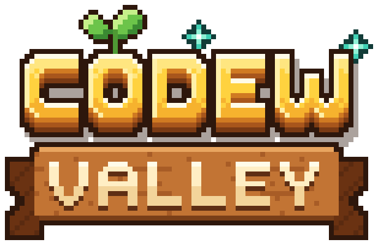
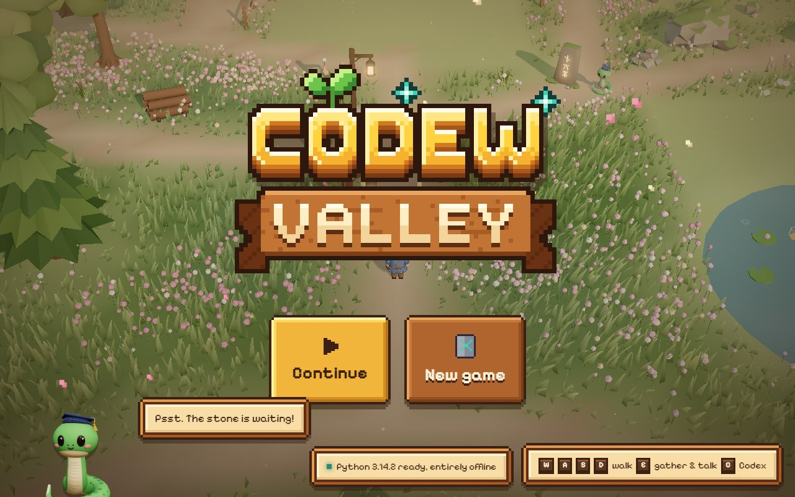
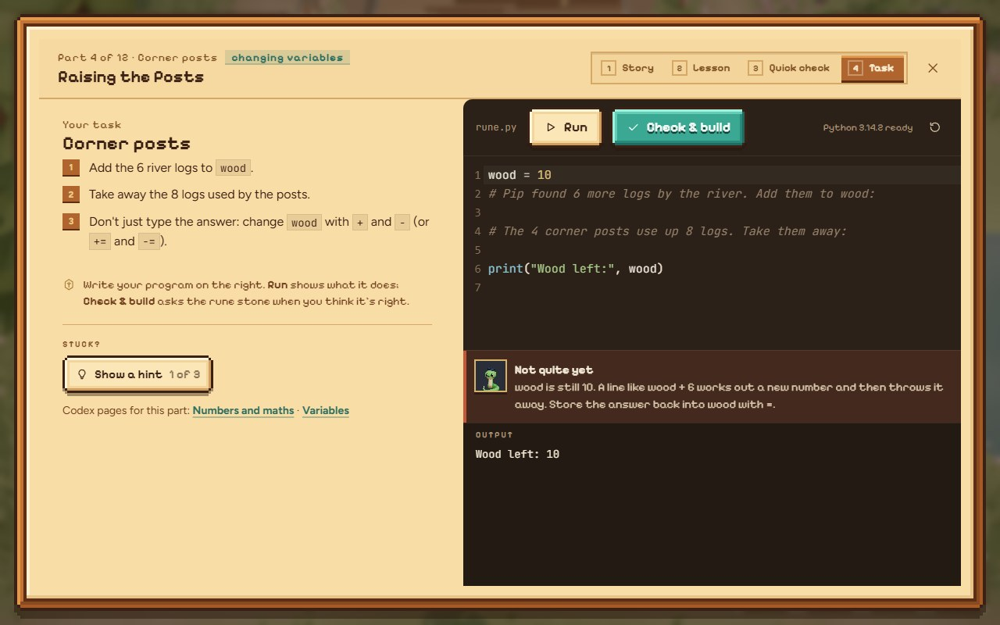
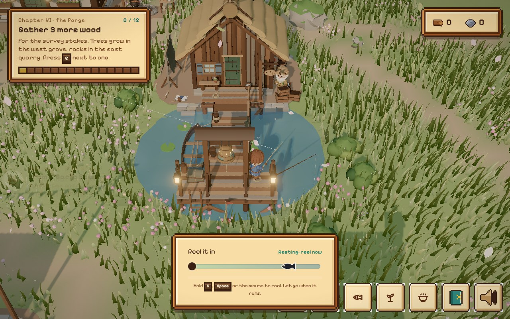
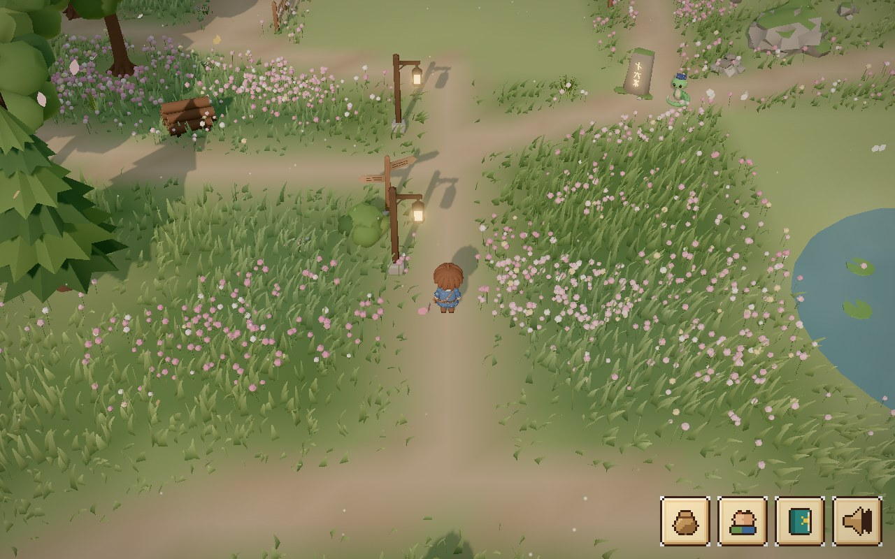

<p align="center">
  
</p>

<p align="center"><b>A cozy 3D village builder that teaches you to code.</b><br>
Version 1.0 · Python</p>

<p align="center">
  
</p>

You inherit an empty valley. Gather wood and stone, walk up to the glowing rune
stone, and speak to it in Python: every challenge you solve raises the next
part of a building, and every building brings a new villager to befriend.
Pip the serpent teaches you along the way, and the in-game Codex explains every
idea, so you never need to search the web.

## What's in 1.0

- **12 buildings, 169 challenges.** From your first `print` to classes,
  recursion and generators: the tavern (strings and variables), the mill
  (if/else), the dock (while loops), the market (lists), the bakery (for loops),
  the forge (functions), the library (dictionaries), the apothecary (text,
  tuples, sets and errors), the town hall (files and CSV), the clock tower
  (modules and comprehensions), the guild hall (classes) and the observatory
  (the capstone).
- **Real Python.** CPython 3.14 runs in your browser (Pyodide in a Web Worker),
  entirely offline. Each challenge has a story, a lesson, a quick check, a task,
  three hints and friendly error messages.
- **Village life.** Fishing, cooking and baking, a bag of gathered things, and
  Wren's daily practice that keeps old topics fresh. Python questions turn up
  at the pond and the kitchen too.
- **Villagers to befriend.** About a hundred everyday sayings each, gifts,
  heart levels, and heart events with their own little cutscenes.
- **A living valley.** Day and night, weather, wind in the grass, music and
  sound.

<p align="center">
  
  
</p>
<p align="center">
  
</p>

## Play it

You need [Node.js](https://nodejs.org) 22 or newer.

```bash
npm install
npm run dev      # then open http://localhost:5190
```

Walk with **WASD** (or click), gather and talk with **E**, open the Codex with
**C**. Your game saves itself in the browser.

```bash
npm test         # checks every Codex example, quiz and challenge with real Python
npm run build    # a static build in dist/
```

## How it's made

- `src/content/`: the Codex, the twelve buildings' challenges, the villagers and their scenes.
- `src/python/`: the Pyodide worker and the grader shared by the game and the tests.
- `src/game/`: the Three.js world, models, weather, particles and sound.
- `src/life/`: fishing, cooking, practice, the bag and friendship.
- `src/ui/`: the HUD, dialogue, rune stone, workbench and Codex book. `UI.md` describes the pixel look.
- `public/models/` and `art/`: models made in Blender (`ART.md` is their contract).
  The logo and icons come from `art/ui/make_logo.py`.

Every challenge is tested: `npm test` fails unless the reference solution
passes, every listed mistake fails, the starter code fails, and each quiz answer
matches what Python really prints.

## Credits

Music and sounds are by the artists listed in `public/audio/CREDITS.md` (CC0
and CC BY; the CC BY pieces are also credited in the game). Fonts: Pixelify
Sans, Figtree and JetBrains Mono (SIL Open Font License).

## Coming next

More languages. Python is the first tongue the valley speaks.

Made by Radhe Patel.
